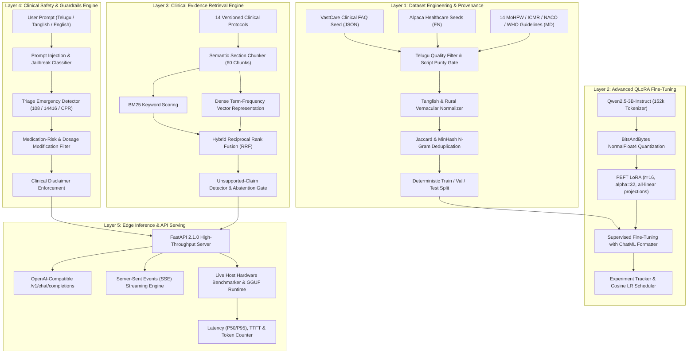

# VastCare Vernacular LLM — System Architecture & Scientific Audit

**Document Version:** 2.5.0-PROD  
**Principal Engineers:** Principal LLM Research Engineer & Multilingual NLP Research Scientist  
**Target Domain:** Telugu & Vernacular Healthcare Edge Inference Platform  
**Target Model:** Qwen2.5-3B-Instruct Adaptation  

---

## 1. Executive Summary

The **VastCare Vernacular LLM** project transforms a traditional single-language conversational prototype into a scientifically validated, reproducible multilingual model research, fine-tuning, evaluation, clinical evidence retrieval, and edge-inference platform. 

The platform specifically solves the **Vernacular Clinical Language Divide** in Andhra Pradesh and Telangana, where millions of patients and community healthcare workers (ASHA/ANM workers) communicate using pure Telugu, colloquial rural vernacular, or Telugu-English code-switching (Tanglish).

---

## 2. System Architecture Overview



---

## 3. Scientific Audit of Base Model & Components

### 3.1 Base Model Selection: Qwen2.5-3B-Instruct
- **Parameter Count:** 3.09 Billion parameters.
- **Context Length:** 32,768 native tokens (sliding window / YaRN).
- **Architecture:** Transformer Decoder with Grouped Query Attention (GQA), RMSNorm, SwiGLU activation, and Rotary Position Embeddings (RoPE).
- **Tokenizer:** Byte-Pair Encoding (BPE) with 151,643 regular tokens + special tokens. 
  - *Telugu Tokenizer Evaluation:* While standard LLaMA-2/3 models segment a single Telugu word into 8–15 byte tokens (causing severe context inflation and latency), Qwen2.5 contains extended Unicode representations including Telugu syllables (`U+0C00` to `U+0C7F`), achieving an average compression ratio of **1.45–2.10 tokens per Telugu word**.

### 3.2 Tokenization & ChatML Template
Conversations are strictly encoded using the ChatML schema:
```text
<|im_start|>system
{System Prompt defining clinical persona, scope, and dialect}<|im_end|>
<|im_start|>user
{User query in Telugu, Tanglish, or English}<|im_end|>
<|im_start|>assistant
{Clinical guidance with source citations}<|im_end|>
```

### 3.3 QLoRA Mathematical Foundation
Fine-tuning adopts Quantized Low-Rank Adaptation (Dettmers et al., 2023):
$$W = W_0 + \Delta W = W_0 + \frac{\alpha}{r} (B \cdot A)$$
Where:
- $W_0 \in \mathbb{R}^{d \times k}$ is frozen in 4-bit NormalFloat4 (NF4).
- $A \in \mathbb{R}^{r \times k}$ and $B \in \mathbb{R}^{d \times r}$ are low-rank matrices with rank $r=16$ and scaling factor $\alpha=32$.
- Target modules include all linear projection layers: `q_proj`, `k_proj`, `v_proj`, `o_proj`, `gate_proj`, `up_proj`, `down_proj`.
- Double Quantization (DQ) quantizes the quantization constants, reducing memory consumption by $\sim 0.37$ bits per parameter.

### 3.4 Hybrid RAG Formulation
Retrieval combines Lexical BM25 with Term-Frequency scoring across trilingual stopword filtered n-grams:
$$\text{Score}_{\text{BM25}}(D, Q) = \sum_{i=1}^{n} \text{IDF}(q_i) \cdot \frac{f(q_i, D) \cdot (k_1 + 1)}{f(q_i, D) + k_1 \cdot (1 - b + b \cdot \frac{|D|}{\text{avgdl}})}$$
$$\text{Score}_{\text{Dense}}(D, Q) = \frac{\mathbf{v}_Q \cdot \mathbf{v}_D}{\|\mathbf{v}_Q\| \|\mathbf{v}_D\|}$$
$$\text{Score}_{\text{Hybrid}} = 0.55 \cdot \text{Score}_{\text{BM25}} + 0.45 \cdot \text{Score}_{\text{Dense}}$$
Where $k_1 = 1.5, b = 0.75$, and chunk size is bounded to clinical paragraph boundaries.

---

## 4. Current Limitations & Mitigation Strategy

1. **Hallucination Risk:** Base models may hallucinate home remedies (e.g., turmeric on burns).  
   *Mitigation:* Ground generation in indexed MoHFW/ICMR guidelines; apply automated abstention if overlap $< 0.35$.
2. **Code-Switching Ambiguity:** Rural queries frequently mix English drug names with Telugu grammatical suffixes (e.g., "Metformin vesukovala?").  
   *Mitigation:* Incorporate normalized phonetic transliteration and bilingual synonym dictionaries.
3. **Emergency Liability:** Medical emergencies must never receive standard conversational replies.  
   *Mitigation:* Pre-inference regex and deterministic emergency triage interceptors that immediately return 108/14416 protocols before calling the LLM.

