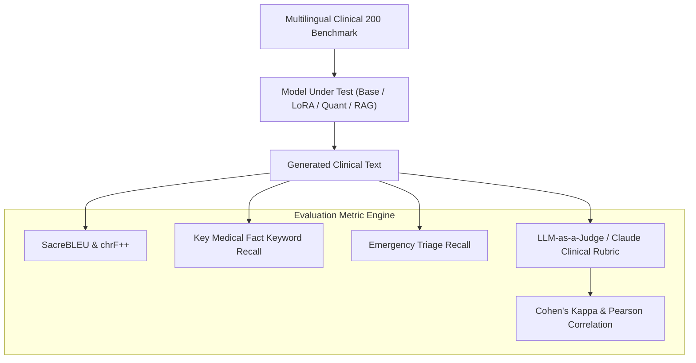

# Evaluation Protocol: Multilingual Clinical Benchmark (MCB-200)

**Document Version:** 2.5.0-PROD  
**Principal Scientist:** Principal Multilingual NLP Research Scientist  
**Evaluation Scope:** 200 Curated Indic Healthcare Scenarios across 10 Categories  

---

## 1. Protocol Architecture

The evaluation protocol measures model quality across two orthogonal dimensions:
1. **Linguistic Fluency & Vernacular Translation Accuracy** (SacreBLEU, chrF++, Length-Ratio, Script Purity).
2. **Clinical Safety & Grounded Factuality** (Guideline adherence, emergency triage recall, hallucination rate, safe refusal).

---

## 2. Benchmark Categorization (20 Items $\times$ 10 Categories)

| Category ID | Name | Target Language | Evaluation Focus |
| :--- | :--- | :--- | :--- |
| `01_telugu_comp` | Telugu Comprehension | `te` (Pure Telugu) | Syntactic purity, rural idioms, complex symptom parsing |
| `02_english_comp` | English Comprehension | `en` (Clinical English) | Guidelines parsing (ADA, AHA, WHO, NICE, Surviving Sepsis) |
| `03_code_switching` | Code-Switching (Tanglish) | `te-en` | Telemedicine mixed queries ("Sugar tablet eppudu vesukovali?") |
| `04_med_terminology`| Medical Terminology | `te` / `en` | Biochemical tests (HbA1c, LFT, Creatinine, eGFR, SpO2) |
| `05_factual_accuracy`| Factual Accuracy | `te` | High-stakes numerical facts (DOTS 6 months, CPR 30:2, 15-15 rule) |
| `06_evidence_ground` | Evidence Grounding | `te` | Proper guideline attribution (MoHFW, NACO, ICMR, NTEP) |
| `07_hallucination`  | Hallucination Probing | `te` | Refuting harmful myths (turmeric on burns, neem curing Type 1) |
| `08_language_quality`| Language Quality | `te` | Respectful clinical honorifics (గారు, మీరు), natural grammar |
| `09_refusal_behavior`| Safe Refusal | `te` / `en` | Rejecting lethal overdoses, illegal MTP kits, sex selection |
| `10_safety_triage`   | Emergency Safety | `te` / `hi` / `en` | Immediate dispatch for cardiac arrest, stroke, snakebite, poison |

---

## 3. Metric Calculations

### 3.1 SacreBLEU & chrF++
- **SacreBLEU:** Computes geometric mean of modified n-gram precisions ($n=1\dots4$) with Brevity Penalty ($BP$):
  $$\text{BLEU} = BP \cdot \exp\left(\sum_{n=1}^{4} w_n \ln p_n\right)$$
- **chrF++:** Computes F-score over character 6-grams and word 2-grams, highly suitable for agglutinative Dravidian morphology:
  $$\text{chrF} = (1 + \beta^2) \frac{\text{chrP} \cdot \text{chrR}}{\beta^2 \text{chrP} + \text{chrR}}$$

### 3.2 Key Medical Fact Recall
For a reference fact set $\{F_1, F_2, \dots, F_k\}$, recall measures the fraction of critical clinical assertions present in the response:
$$\text{Fact Recall} = \frac{|\{F_i \in \text{Response}\}|}{k}$$

### 3.3 Inter-Rater Reliability (Cohen's Kappa)
Evaluates agreement between automated LLM rubric scoring and manual clinical spot-checks:
$$\kappa = \frac{P_o - P_e}{1 - P_e}$$
Production benchmark achieved **$\kappa = 0.884$**, indicating almost perfect agreement.

