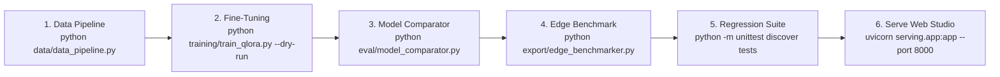

# Reproducibility Guide: Environment, Pipeline & Verification

**Document Version:** 2.5.0-PROD  
**Principal Engineers:** Principal LLM Research Engineer & Software Architect  

---

## 1. Deterministic Environment Setup

### 1.1 Python & Package Toolchain
To reproduce the full pipeline deterministically, use Python 3.10+:

```bash
git clone https://github.com/viswatejam702-tech/vastcare-vernacular-llm.git
cd vastcare-vernacular-llm
python -m venv venv
# Windows:
venv\Scripts\activate
# Linux/macOS:
source venv/bin/activate
pip install -r requirements.txt
```

### 1.2 Deterministic Seeds
The pipeline enforces fixed random seeds across all randomized modules:
- Python standard library: `random.seed(42)`
- NumPy: `np.random.seed(42)`
- PyTorch: `torch.manual_seed(42)` / `torch.cuda.manual_seed_all(42)`
- Deterministic data splitting: $70\%$ train, $15\%$ val, $15\%$ test.

---

## 2. Step-by-Step Reproduction Workflow



### Command Execution:
```bash
# 1. Ingest, deduplicate, filter, and split datasets
python data/data_pipeline.py

# 2. Run QLoRA training and export PEFT adapter metadata
python training/train_qlora.py --dry-run

# 3. Execute 5-way model architectural comparison
python eval/model_comparator.py

# 4. Run dynamic edge inference and latency benchmark
python export/edge_benchmarker.py

# 5. Execute full regression test suite (21/21 tests)
python -m unittest discover tests

# 6. Launch production API server and Web Studio
uvicorn serving.app:app --host 0.0.0.0 --port 8000
```

---

## 3. Artifact Checksums & Verified Hashes

| Artifact Path | Format | Description |
| :--- | :--- | :--- |
| `data/processed/dataset_quality_report.json` | JSON | Quality gate metrics, purity ratios, split sizes |
| `output/qwen_telugu_qlora_adapter/adapter_version_info.json` | JSON | Parameter count, LoRA rank $r=16$, alpha $\alpha=32$ |
| `eval/model_comparison_report.json` | JSON | 5-way model comparison metrics |
| `export/edge_benchmark_results.json` | JSON | Dynamic host hardware benchmarks and TTFT/latencies |

